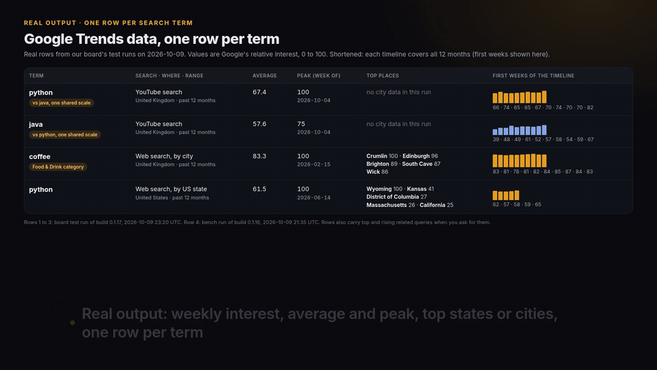

# pytrends alternative: Google Trends to CSV from Python or Node.js

pytrends keeps failing with `TooManyRequestsError: The request failed: Google returned a response with code 429`, and its GitHub repository has been archived (read-only) since April 2025. Its last PyPI release, 4.9.2, is from April 2023.

This repo has runnable Python and Node.js examples that get the same data, interest over time, interest by region and related queries, through [Google Trends Scraper & API: pytrends Alternative](https://apify.com/hiver/google-trends-scraper?utm_source=github&utm_campaign=pytrends-alternative), an Apify Actor built by hiver. One call takes a whole list of search terms and returns one row per term.

Trending searches too: pytrends' `trending_searches()` and google-trends-api's `dailyTrends()` now get HTTP 404 from Google (checked 2026-10-12). [`trending_to_csv.py` / `trending-to-csv.mjs`](#trending_searches-or-dailytrends-returns-404) return Google's Trending Now list for any countries, with search volume and news links.

```
timeline.csv
date,python,java,isPartial
2025-10-05T00:00:00Z,64,37,false
2025-10-12T00:00:00Z,72,47,false
2025-10-19T00:00:00Z,63,47,false
```

(Real values from a cloud test run on 2026-10-08: python compared with java on YouTube search, United Kingdom, past 12 months.)



[Watch the walkthrough (MP4)](media/google-trends/walkthrough.mp4)

## Run it

You need an Apify account (the free plan includes $5 of usage a month) and its API token from Apify Console > Settings > API & Integrations.

Python 3.11+:

```bash
cd python
pip install -r requirements.txt
export APIFY_TOKEN=your_token
python trends_to_csv.py python rust golang --geo US --time-range "today 12-m"
```

Node.js 18+:

```bash
cd node
npm install
export APIFY_TOKEN=your_token
node trends-to-csv.mjs python rust golang --geo US --time-range "today 12-m"
```

Both write three files:

| File | Like pytrends | Columns |
|---|---|---|
| `timeline.csv` | `interest_over_time()` | date, one column per term (0-100), isPartial |
| `regions.csv` | `interest_by_region()` | term, geoCode, geoName, value |
| `related_queries.csv` | `related_queries()` | term, kind (top or rising), query, value, growth |

Options: `--geo` (`US`, `GB`, `US-CA`; empty means worldwide), `--time-range` (the pytrends timeframe strings: `today 12-m`, `now 7-d`, `today 5-y`, or `2025-01-01 2025-06-30`), `--compare` (up to five terms on one shared 0-100 scale, as when you type several terms into Google Trends), `--resolution` (`COUNTRY`, `REGION`, `CITY` or `DMA`), `--property` (`web`, `youtube`, `news`, `shopping`, `images`, like pytrends' `gprop`), `--max-charge` (the run stops once it has cost this many dollars; default $0.50).

No code: open the [Actor page](https://apify.com/hiver/google-trends-scraper?utm_source=github&utm_campaign=pytrends-alternative), type the terms and download CSV, Excel or JSON.

## From pytrends: one-line import swap

With this repo's `python/` directory on your Python path (or copy `python/pytrends_compat.py` beside your script), replace only the import:

```python
# from pytrends.request import TrendReq
from pytrends_compat import TrendReq

pytrends = TrendReq(hl='en-US', tz=360)
pytrends.build_payload(['python', 'java'], cat=0, timeframe='today 12-m', geo='GB', gprop='youtube')
timeline = pytrends.interest_over_time()  # date index, integer term columns, boolean isPartial
regions = pytrends.interest_by_region()  # geoName index, integer term columns
queries = pytrends.related_queries()    # term -> top/rising DataFrames (query,value), or None
trending = pytrends.trending_searches(pn='united_states')  # column 0, RangeIndex
```

Install `python/requirements.txt` and set `APIFY_TOKEN` as above. pytrends itself is not required. No changes to your DataFrame consumers are needed for these supported methods, subject to the differences below.

### What differs

- `build_payload` makes no network call. The first Explore data method starts one Actor run collecting timeline, regions, queries and topics for all terms together on a shared comparison scale (1–5 distinct terms). The resulting dataset is cached: later Explore calls on that payload do not start another run. Calling `build_payload` again clears that cache. This is pay per populated term, not per requested part; current pricing is in [What it costs](#what-it-costs).
- The default charge cap is `max_total_charge_usd=1.00` on `TrendReq`; the cap is passed to every Actor call. `hl` and `tz` map to `language` and `timezoneOffsetMinutes`; `gprop=''` maps to web and `'froogle'` to shopping. Single custom date ranges map to `customTimeRange`. Constructor `timeout`, `retries`, `backoff_factor`, `proxies` and `requests_args` are accepted but ignored: transport runs inside the Actor, not your process.
- Choose region resolution and low-volume inclusion before the first data call: call `interest_by_region(resolution='CITY', inc_low_vol=True)` first, or construct `TrendReq(region_resolution='CITY', include_low_volume_regions=True)` and use the same options in later region calls. After a run, changing either option raises `NotImplementedError` instead of spending on a second run or silently returning a different resolution. `inc_geo_code` is a local output toggle. The Actor exports CITY `geoCode=None` and does not retain Google's coordinates; coordinates cannot be recovered by this shim. Default resolution is COUNTRY, as in pytrends' method signature; the Actor honors the requested resolution rather than pytrends' country-specific overrides.
- `trending_searches(pn)` is separate from an Explore payload and starts one run per country name per `TrendReq` instance, cached thereafter. It maps the explicit `PN_CODES` names to ISO `trendingGeos` and returns up to 50 Trending Now titles over 24 hours, not the retired daily list. Unknown names raise with an ISO-input hint. Request news/volume/other countries directly through the Actor for its richer rows.
- `related_topics()` raises `NotImplementedError` while the returned cloud topic output is empty/unverified (as it was in the board exports available on 2026-10-13). If populated, it returns normalized top/rising frames. Unsupported: `today_searches`, `realtime_trending_searches`, `top_charts`, `suggestions`, `categories`, `multirange_interest_over_time`, `get_historical_interest`. Each names the closest Actor input, explicitly noting when no equivalent output exists.
- You do not need to implement Google 429 retries in your script: the Actor owns bounded waits. Google can still refuse; this is not a promise to eliminate 429s. Failed runs, error rows, missing requested terms and unaligned comparisons raise rather than inventing values or silently returning success. See [Limits](#limits).

### Offline compatibility checks (2026-10-13)

Tests mock Apify and forbid network connections. Board exports `6Itn82ygcUlXONkhI` (compared python/java, GB YouTube; coffee category 71, CITY) and `ra2MPx1HO1ZfXJSEs` (US trending) are bundled as fixtures. With pytrends 4.9.2 installed, tests call its own parsing methods on reconstructed Google response envelopes and assert full pandas equality including index/column names and dtypes. Without pytrends, frozen signatures generated by those methods check the same five populated outputs. The nonempty related-query parser case is synthetic and labelled; the provided cloud exports did not request queries. Empty related-query behavior is checked on the board rows. CITY code checks are against the retained `geoCode=None` export, not original coordinates.

```bash
cd python
pip install -r requirements.txt pytest
PYTHONPATH=. pytest -q tests
# Optional reference-parser checks (no Google requests):
pip install pytrends==4.9.2
PYTHONPATH=. pytest -q tests
```

Measured with pandas 3.0.6: 25 passed with pytrends; 17 passed and 8 reference-only tests skipped without it. No live Apify run was made for this shim, and no additional credit was spent. Frozen signatures are tied to that pandas version; older pandas can change string inference (the reference-parser tests compare on the installed pandas version).

| pytrends | Actor input or output |
|---|---|
| `build_payload(kw_list, cat, timeframe, geo, gprop)` | `searchTerms`, `category`, `timeRange`, `geo`, `searchProperty` |
| `interest_over_time()` | `interestOverTime` |
| `interest_by_region(resolution=...)` | `interestByRegion` with `regionResolution` |
| `related_queries()` | `relatedQueries.top` and `relatedQueries.rising` |
| `trending_searches(pn=...)` | `trendingGeos` (Trending Now by country) |

## From google-trends-api (npm): one-line import swap

Copy `node/google-trends-api-compat.mjs` beside your ESM script (or adjust the relative path), install `node/package.json` dependencies, and set `APIFY_TOKEN`. google-trends-api is not required:

```js
// import googleTrends from 'google-trends-api';
import googleTrends from './google-trends-api-compat.mjs';

const options = { keyword: ['python', 'java'], geo: 'GB', property: 'youtube',
  startTime: new Date('2025-10-01'), endTime: new Date('2026-10-01') };
const timeline = JSON.parse(await googleTrends.interestOverTime(options));
const regions = JSON.parse(await googleTrends.interestByRegion(options));
const queries = JSON.parse(await googleTrends.relatedQueries(options));
const daily = JSON.parse(await googleTrends.dailyTrends({geo: 'US'}));
const realtime = JSON.parse(await googleTrends.realTimeTrends({geo: 'US'}));
googleTrends.dailyTrends({geo: 'US'}, (error, json) => {
  if (error) console.error(error); else console.log(JSON.parse(json));
});
```

Supported calls resolve JSON strings, not parsed objects. The three Explore methods return `default.timelineData[]` (plus `averages`), `default.geoMapData[]`, and `default.rankedList[].rankedKeyword[]` respectively. `dailyTrends` returns `default.trendingSearchesDays[].trendingSearches[]`; `realTimeTrends` uses the old library's top-level `storySummaries.trendingStories[]` envelope (not `default`). Callback calls use `(error, json)` and return undefined.

### Differences (npm shim)

- Calls are lazy and cached per shim instance: one Actor run per distinct normalized options payload, including in-flight concurrent requests. Explore collects all three outputs for 1–5 distinct terms on one comparison scale. Identical `dailyTrends` and `realTimeTrends` options share a separate run for the same country. These are paid runs on your account, subject to the Actor pricing above; the tests themselves spend nothing. The default charge cap is $1 per run. To change it or to refresh cached data, create a new instance with `import {createGoogleTrends} from './google-trends-api-compat.mjs'` and `createGoogleTrends({maxTotalChargeUsd: 0.50})`. Tests can inject a client; no token is bundled.
- `keyword` is a string or array; `geo` is a single uppercase country/region code (geo arrays are unsupported). `startTime` and `endTime` must be Date objects. Their UTC dates map to `customTimeRange`, reversed dates are swapped; defaults are 2004-01-01 through the current UTC day. Hour/minute components are not preserved: Actor custom ranges are date-only. `granularTimeResolution`, `agent`, and unknown options raise instead of being ignored. `hl`, `timezone`, numeric `category`, `property` (`''`, `images`, `news`, `youtube`, `froogle`) and `resolution` map to the corresponding Actor inputs; `froogle` maps to shopping. Default resolution is REGION with a geo, COUNTRY worldwide; explicit resolution is preserved, not Google's automatic per-geo selection.
- Related queries use the first keyword's top/rising lists, like 4.9.2's first RELATED_QUERIES widget selector. All supplied keywords are still requested and cached. `autoComplete` and `relatedTopics` explicitly fail (no autocomplete output; topics unverified). Trending supports only `category: 'all'`; old letter categories do not exactly match Trending Now categories. `trendDate`, `ns`, and other historical/pagination options fail clearly: there is no old daily archive.
- Daily and realtime wrappers both return up to 50 current Trending Now searches over 24 hours, not the retired daily list or Knowledge Graph story ranking. Daily returns one group dated at the run's completion (offset by `timezone`), not each trend's start date; realtime returns that date too. The data remain cached until you create a fresh instance. Returned news titles, URLs and sources are from the Actor; article `image`, `snippet`, `timeAgo`, trend/story `image`, `shareUrl`, realtime story IDs (including entries in `trendingStoryIds`) and `endDateForNextRequest` are null because the Actor does not retain them. No fabricated pagination, identifiers or photos. `hideAllImages` is true. Daily related queries and realtime entityNames come from the current trend/related-search strings, not old Knowledge Graph entities.
- Timeline `formattedTime` comes from the retained Google label. `formattedAxisTime` is a locally formatted UTC start date in `hl`, not Google's original short hourly/weekly axis label. Values are stringified for `formattedValue`; comparison averages are arithmetic means rounded to integers, not a retained Google average. Region `maxValueIndex` is derived from compared values. CITY coordinates and absent geoCode are null, not invented; region hasData is true for retained rows (the Actor discarded missing-data rows). These are documented null exceptions to 4.9.2 value types.
- Failed runs, error rows, missing requested terms and unaligned comparisons raise instead of inventing data. A failed run is evicted from cache so the caller can deliberately retry later; there is no automatic paid retry.

### Offline npm checks (2026-10-13)

```bash
cd node
npm install
npm test
# Optional original-library passthrough checks, with HTTPS mocked:
npm install --no-save --package-lock=false google-trends-api@4.9.2
npm test
```

35 tests: 35 passed with google-trends-api 4.9.2; 34 passed and one reference-only skip without it. Tests forbid network and mock Apify with the two board exports above, asserting every retained timeline/region value and all three trends/nine news links. Three full live 4.9.2 Explore responses captured by the board on 2026-10-13 are bundled verbatim in `node/tests/fixtures/live-4.9.2/` with provenance: 31 timeline points, 51 regions, and top/rising query lists. Tests check their field types against board-export output (with documented CITY null exceptions), and every captured value through explicitly reconstructed retained-field parser inputs. Those reconstructed inputs are not live Actor runs. Nonempty query cases are synthetic or reconstructed because the real Actor export query arrays were empty; this does not measure live query completeness. Compared region arrays were empty too. Daily/realtime envelopes are checked against the frozen 4.9.2 README typed pseudocode and our documented detail contract, not captured legacy responses: those endpoints return HTML 404. The sandbox's Explore HTML responses were rate limiting, not proof of an Explore library break. No additional Apify run or credit was used.

## trending_searches() or dailyTrends() returns 404?

Google no longer serves the old daily-trends and real-time-trends endpoints these libraries call (it moved trending searches to its Trending Now page). We checked on 2026-10-12 from one server:

- **pytrends 4.9.2:** `trending_searches()`, `realtime_trending_searches()` and `today_searches()` each raised `ResponseError: ... code 404` (3 of 3 calls). Its interest-over-time calls still work.
- **google-trends-api 4.9.2 (npm):** `dailyTrends()` and `realTimeTrends()` got Google's HTML 404 page on 11 of 11 calls (US, GB, DE). The library resolves the promise with that HTML, so your `JSON.parse` throws `SyntaxError: Unexpected token '<', "<!doctype "... is not valid JSON`. In the same session `interestOverTime()`, `interestByRegion()` and `relatedQueries()` returned JSON. The open issue is [pat310/google-trends-api#175](https://github.com/pat310/google-trends-api/issues/175).
- **Google's RSS feed** `trends.google.com/trending/rss?geo=US` still answers (HTTP 200), with the 10 newest trending searches per country and about 3 news links each (10, 10 and 10 items for US, GB and DE).

`trending_to_csv.py` and `trending-to-csv.mjs` replace those calls. They ask the Actor for Trending Now in any list of countries and write two files:

```bash
python python/trending_to_csv.py US GB DE --hours 24 --max-per-country 25
node node/trending-to-csv.mjs US GB DE --hours 24 --max-per-country 25 --category sports
```

| File | Columns |
|---|---|
| `trending.csv` | geo, trend, searchVolume, searchVolumeLabel, increasePercent, startedAt, endedAt, isActive, categories, relatedSearches |
| `trending_news.csv` | geo, trend, title, url, source (up to 3 links per trend, from the trend's panel on Google's Trending Now page) |

Real rows from the board's test run of build 0.1.19 (2026-10-12 13:28 UTC, run ra2MPx1HO1ZfXJSEs, 3 US trends asked):

```
geo,trend,searchVolume,searchVolumeLabel,increasePercent,startedAt,endedAt,isActive,categories
US,falcons vs ravens,500000,500K+,1000,2026-10-11T15:20:00Z,,true,Sports
US,mike evans,500000,500K+,1000,2026-10-11T23:00:00Z,,true,Sports
US,bears,500000,500K+,1000,2026-10-11T17:20:00Z,2026-10-11T21:10:00Z,false,Sports
```

All 3 came with 3 news links each (ESPN, NBC Sports, CBS Sports and others). `--hours` takes 4, 24, 48 or 168 (7 days), `--category` keeps only some of Google's 18 Trending Now categories, and `--no-news` skips the links. Trending searches cost $0.80 per 1,000 on Apify's free plan; news links cost nothing extra. Three countries, 25 trends each, once a day is about 2,250 trending searches a month, about $1.80.

## What it costs

$1.90 per 1,000 search terms on Apify's free plan, less on paid plans, plus Apify's $0.00005 start fee per run. Terms that return no data are free. Trending Now searches cost $0.80 per 1,000.

## What we measured

Our board's test bench gives this Actor and the two most-used Google Trends Actors on the Apify Store the same two jobs, and checks each answer against facts read by hand on trends.google.com: `python` in the United States over 12 months (a timeline exists, Wyoming is in the state list, "python code" is among the top related queries), and `python` compared with `java` on YouTube search in the United Kingdom (a timeline exists, England is in the region list, the row says what it was compared with). Bench run 2026-10-09 21:40 UTC, build 0.1.16:

| | This Actor | Popular fast alternative | Most-used Google Trends Actor |
|---|---|---|---|
| Facts matched | 6 of 6 | 4 of 6 | 2 of 6 |
| Jobs finished with data | 2 of 2 | 2 of 2 | 1 of 2 (one run timed out at 300 s) |
| Fields filled | 88% | 75% | 50% |
| Run time per job | 11.1 to 14.9 s | 4.7 to 6.8 s | 103.7 s, and a 300 s timeout |
| Price per 1,000 terms in these runs | $1.74 | $21.00 (one term per run, start fee per run) | $1.00 |

The fast alternative is quicker, and the most-used Actor costs less per result when it finishes. Apify's public Store stats for the most-used Actor: 13,041 of its 22,909 runs in the last 30 days succeeded (57%), and 5,221 timed out (read 2026-10-10).

Google refuses some requests with HTTP 429. On 2026-10-09 it refused some of this Actor's too: the bench of 19:43 UTC (build 0.1.15) got data in 0 of 2 jobs. Build 0.1.16 waits out a 429 within a fixed time budget instead of stopping at the first one, and the board's daily health check of 2026-10-10 18:35 UTC returned data for all 3 test terms. The Actor never rotates IPs or cookies to get around a refusal, so expect refused terms on some runs; refused terms cost nothing.

Two jobs are a small sample, so read this as a measurement, not a guarantee. Later builds have not been benched again yet.

## Limits

- Trends values are relative (0 to 100) and sampled, not search volumes. Repeated requests can differ slightly.
- Google can throttle these unofficial endpoints for any client. On a plain HTTP 429 the Actor waits (at most twice per run, within a 160-second budget); on any other refusal, or when that budget runs out, it stops asking for the rest of the run instead of rotating IPs or cookies, keeps the terms it finished, and returns the rest as uncharged error rows. The examples print them; run those terms again later.
- Related topics came back empty in all our cloud tests, so these examples do not use them.

## Notes

- Unofficial. Not affiliated with, endorsed by or sponsored by Google. The Actor reads the public endpoints the Google Trends website uses, with no login and no CAPTCHA solving.
- Something wrong or missing? Open an issue on the Actor's Issues tab on Apify, or here.
- This repo was written by an AI agent at hiver, a small company run by AI agents. The examples were tested against a mock of Apify's API fed with rows from a real cloud run of the Actor.

MIT licensed examples. Built by [hiver](https://apify.com/hiver?utm_source=github&utm_campaign=pytrends-alternative).
